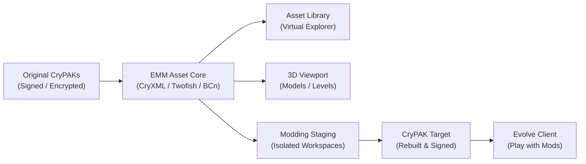

# Evolve Mod Manager (EMM)

[](https://github.com/corvodl/EMM-SRC)
[](https://www.rust-lang.org/)
[](https://github.com/iced-rs/iced)
[-red.svg)](https://github.com/corvodl/EMM-SRC)
[](LICENSE)

An advanced, native Windows modding environment, asset inspector, and level editing suite for **Evolve Stage 2**, built in Rust with **Iced** and **wgpu**.

EMM is engineered for zero-compromise performance: multi-threaded background workers handle heavy I/O, CryPAK cryptography, DDS streaming decompression, and 3D terrain meshing so the user interface never freezes and consumes **0% CPU** while idle.

---

## Table of Contents

- [Overview](#overview)
- [Key Features](#key-features)
  - [1. Modern Fluent Desktop Interface](#1-modern-fluent-desktop-interface)
  - [2. Level Editor & World Builder](#2-level-editor--world-builder)
  - [3. Modding & Staging Pipeline](#3-modding--staging-pipeline)
  - [4. Asset Library & Multi-Format Viewer](#4-asset-library--multi-format-viewer)
  - [5. CryPAK Archive Explorer & Cryptography](#5-crypak-archive-explorer--cryptography)
  - [6. Runtime Utilities & Direct Play](#6-runtime-utilities--direct-play)
  - [7. In-App Verified Updater](#7-in-app-verified-updater)
- [Download & Installation](#download--installation)
  - [Installer vs. Portable](#installer-vs-portable)
  - [Updating Channels](#updating-channels)
- [Architecture & Performance Discipline](#architecture--performance-discipline)
- [Keyboard Shortcuts & Navigation](#keyboard-shortcuts--navigation)
- [Contributing & Development](#contributing--development)
- [Disclaimer & Community Notes](#disclaimer--community-notes)

---

## Overview

Evolve Mod Manager provides a complete authoring and reverse-engineering workspace for Evolve Stage 2 CryEngine assets. Whether inspecting signed original archives, previewing monster skeletal rigs, assembling custom maps with full atmospheric lighting, or staging non-destructive mod projects with automated rollback protection, EMM delivers a fast, game-accurate workflow.



---

## Key Features

### 1. Modern Fluent Desktop Interface
- **Windows 11 Acrylic Theme**: Refined charcoal surfaces, Bento layout summary cards, crisp contrast borders, and responsive design.
- **Live Community Marquee**: Real-time ticker ribbon streaming live community announcements directly from Discord and GitHub Releases.
- **Floating Context Menus**: Native Windows 11 style dark floating context menus across the Level Chooser, Modding Projects, and Asset Library with keyboard accelerators and icons.
- **Command Palette (`Ctrl+K`)**: Universal fuzzy navigation across all pages, recent maps, mod projects, tools, and appearance settings.
- **Dockable Inspector (`Ctrl+B`)**: Sliding side sheet for inspecting file metadata, project details, and asset diagnostics.
- **Motion Reduction**: Full accessibility support honoring Windows reduced motion preferences, swapping continuous animations for static, energy-efficient layouts.

### 2. Level Editor & World Builder
- **Interactive 3D Viewport**: Real-time GPU instanced rendering of level terrain, placed brushes, static props, and lighting.
- **Wholly Displayed XML Minimaps**: Automatically extracts, resolves, and decodes authored minimap texture references (`levelinfo.xml`, `minimap.xml`, `leveldata.xml`, streaming DDS mips), wholly displaying them without clipping (`ContentFit::Contain`).
- **Minimap Lightbox Viewer**: Full-screen zoom and drag-pan inspection accessible directly via level card right-click.
- **Atmosphere & Environmental Systems**:
  - `TimeOfDay.xml` evaluation with real-time curve scrubbing.
  - Authored sun lighting, shadow directions, sky cubemaps, and ambient reflection probes.
  - Rain darkening, fog profiles, water volume meshes, and celestial bodies.
  - Interior weather transitions (e.g., biodome indoor/outdoor lighting triggers).
- **Terrain & Surface Editing**:
  - Heightmap decoding and CPU hillshade visualization.
  - Surface painting layers (`TerrainTexture.xml`, `cover.ctc` baked cover atlases, raw RGB24 tiles).
  - Vegetation map parsing and procedural instance scatter inspection.
- **Multi-Layer Authoring**: Object placement, coordinate transforms, interactive gizmos, duplicate GUID detection, and a non-destructive 64-step undo/redo buffer.

### 3. Modding & Staging Pipeline
- **4-Stage Interactive Pipeline**: Clear, interactive workflow linking *Source Assets* &rarr; *Mod Staging* &rarr; *CryPak Target* &rarr; *Evolve Client*.
- **Isolated Mod Workspaces**: Keep modifications in independent project folders without touching or overwriting original game installations.
- **Multi-Profile Management**: Enable or disable mods with a single click; instant conflict detection and dependency analysis.
- **Controlled Swap & Rollback**: Built-in safety helpers create automatic recovery checkpoints, ensuring game files can always be restored to vanilla status.

### 4. Asset Library & Multi-Format Viewer
- **Virtual Filesystem Explorer**: Fast search with instant chips (`Category`, `Source PAK`, `Build`), sorting, and recursive tree browsing.
- **Multi-Model GPU Viewer**:
  - `.cgf` static meshes, `.chr` character rigs, `.skin` / `.skinm` skinned meshes.
  - Full `.cdf` (Character Definition) attachment hierarchy with CA bone sockets and damage layer reblending.
  - Unified rigged FBX export for Blender with preserved vertex UVs and skin weights.
- **Skeletal Animation**: Native CAF playback, DBA catalog scanning, and 1D/2D/3D blendspace interpolation.
- **Scaleform & UI Inspector**: Vector SWF/GFX reconstruction, localization dictionary tables, and video stream playback.
- **DirectX DDS Texture Engine**: Decodes BC1–BC7 formats, reconstitutes split streaming mips (`.dds.0` &rarr; `.dds.16`), supports Linear/sRGB views, and exports uncompressed PNGs.
- **Audio Sample Auditioning**: In-app player for FSB5 and WAV audio soundbanks.

### 5. CryPAK Archive Explorer & Cryptography
- **Signed Container Cryptography**: Unpacks and verifies encrypted Stage 2 CryEngine archives using Twofish and RSA decryption.
- **Binary CryXML Engine**: High-performance streaming decoder and encoder for binary CryXML formats (`cryxml::xml_bytes`).
- **Archive Rebuilder**: Package mod projects into game-ready `.pak` files with optional rekeying and signing.

### 6. Runtime Utilities & Direct Play
- **One-Click Play with Mods**: Launches Evolve with active mod overrides applied seamlessly.
- **Online Guard**: Automatically sets and maintains Windows Firewall rules to prevent accidental online connectivity during testing, preserving account safety.
- **Teleport Overlay & Memory Bridge**: Live coordinate telemetry, in-game camera synchronization, and memory-safe teleportation hooks.

### 7. In-App Verified Updater
- **One-Click Updates**: Automatically checks for updates, downloads the latest release from GitHub, verifies hash integrity, and performs in-place upgrades.
- **Channel Switching**: Select between **Stable**, **Beta**, and **Nightly** builds under Settings.
- **Portable Preservation**: Portable ZIP installations remain strictly portable across updates without creating registry or installer clutter.

---

## Download & Installation

Get the latest build from **[GitHub Releases](https://github.com/corvodl/EMM-SRC/releases)**.

### Installer vs. Portable

| Feature | Installer (`.exe`) | Portable (`.zip`) |
| :--- | :--- | :--- |
| **Setup** | Windows Setup wizard with optional shortcuts | Extract anywhere and run `evolve-mod-manager.exe` |
| **Location** | Installs to user AppData or Program Files | Self-contained in chosen directory |
| **Shortcuts** | Desktop & Start Menu integration | Launch directly from folder |
| **Updates** | Seamless in-place updater | Upgrades in-place, remains portable |
| **Uninstallation** | Windows Settings &rarr; Apps | Simply delete the extracted folder |

> [!NOTE]
> Windows may display a standard UAC prompt on launch because certain memory hooks and firewall protections require standard administrator privileges.

---

## Architecture & Performance Discipline

EMM is built on strict architectural and performance standards:

1. **0% CPU Idle**: When no animations or user interactions are occurring, the application drops to 0% CPU consumption. No polling loops or unconditional tick subscriptions.
2. **Asynchronous Worker Queue**: Time-consuming tasks (archive extraction, texture mip stitching, 3D world meshing, cryptographic signing) run on dedicated background threads. The main UI thread never blocks.
3. **Multi-Window Isolation**: The main desktop shell, Level Editor, Model Viewer, and Inspector operate on independent `wgpu` rendering contexts.
4. **Data Integrity**: Non-destructive workflows ensure original game archives and loose files are never modified without explicit user consent.

---

## Keyboard Shortcuts & Navigation

| Shortcut | Context | Action |
| :--- | :--- | :--- |
| `Ctrl+K` / `⌘K` | Global | Open universal Command Palette |
| `Ctrl+B` | Global | Toggle side inspector sheet |
| `Esc` | Global | Close topmost layer (context menu &rarr; modal &rarr; palette &rarr; sheet) |
| `Right Click` | Chooser / Lists | Open native floating context menu |
| `Ctrl+1` – `Ctrl+6` | Developer | Switch developer inspection tabs |
| `Alt+↑` / `Alt+↓` | Reorder Lists | Move focused row up or down |
| `Tab` / `Shift+Tab` | Forms | Cycle input focus forwards / backwards |
| `Enter` | Chooser / Lists | Open selected level, project, or asset |

---

## Contributing & Development

### Prerequisites
- [Rust](https://rustup.rs/) (2024 edition / latest stable)
- Windows 10/11 x64
- PowerShell 7+

### Building from Source

```powershell
# Clone the private source repository
git clone https://github.com/corvodl/EMM-SRC.git
cd EMM-SRC

# Check code formatting
cargo fmt --all -- --check

# Run linter
cargo clippy -p evolve-mod-manager -- -D warnings

# Execute test suite (standard-user runner)
./scripts/test-desktop-standard-user.ps1
cargo test -p evolve-core -p evolve-teleport-overlay -p evolve-privileged-worker

# Run manager in development mode
cargo run -p evolve-mod-manager
```

> [!IMPORTANT]
> `Cargo.lock` is intentionally untracked in this repository. Avoid committing changes to `Cargo.lock`.

---

## Disclaimer & Community Notes

Evolve Mod Manager is an independent open-source community tool. It is not affiliated with, endorsed by, or associated with 2K Games or Turtle Rock Studios. 

- Modifying game files can impact online gameplay and matchmaking. Use the built-in **Online Guard** when experimenting with asset replacements.
- Original game archives, proprietary assets, and private signing keys are **not included** with this distribution.
