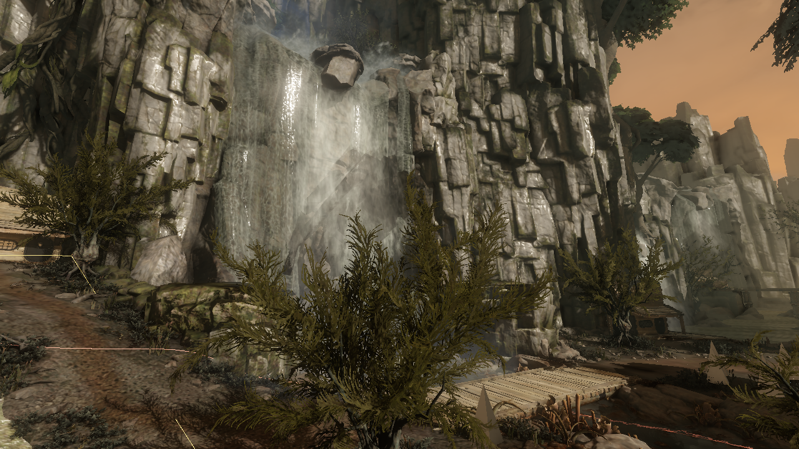
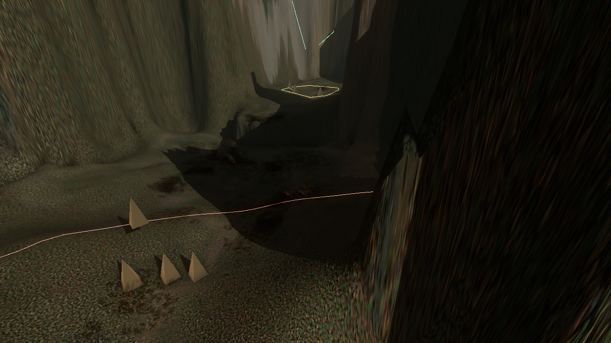
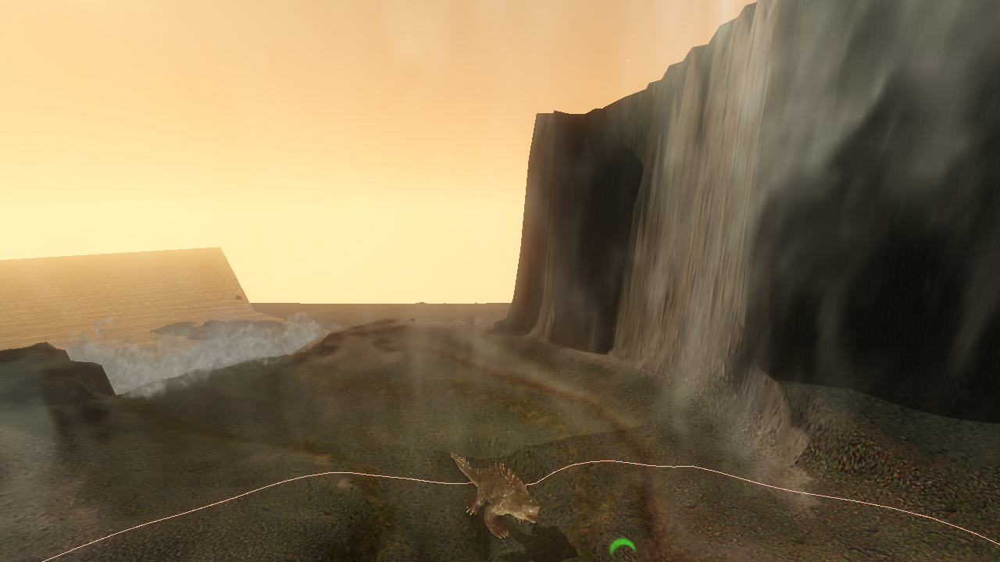

# Imported Level Editor — PR #130 (experimental)

## 2012 Xbox 360 map archives

Import `Game/Levels/<map>/level.pak` to open that map. The Asset Library and
map chooser show `<map>` as the level name and expose the original source path,
including `level.pak`, to distinguish identically named maps across builds.
`terraintexture.pak` beside it contains baked terrain colors; it remains an
importable dependency but is not a level and cannot be opened as one. Import
the other same-build Game and streaming PAKs to make original geometry and
materials available to the read-only scene preview.

The root `mission_mission0.xml` placement parser opens 2012 map entities. The
read-only compiled-terrain importer recognizes the 2012 version-24 heightmap,
brush and vegetation layouts separately from Stage 2 version 25. Baked color
uses `terrain/cover.ctc` when its color format can be decoded; maps with an
unsupported cover color format can use their own imported sibling
`terraintexture.pak` RGB24 tile grid instead. The other same-build PAKs supply
object geometry and textures. Version-24 compiled terrain edits are blocked;
this is a source-backed viewport preview, **not** Xbox 360 shader, particle,
lighting or rendering parity. Unsupported octree record types remain diagnosed
rather than substituted with unrelated assets.

Version-24 vegetation records put brightness at byte 56 and Z/X/Y rotation at
bytes 57–59, just like version 25. Reading brightness as the first angle tilts
foliage incorrectly; regression tests keep yaw-only plants upright. Brush
matrices retain their separate source-authored orientation and scale.

Import both `Game/streaming/dds_low.pak` and `Game/streaming/dds_high.pak`
from this same build for the complete cooked texture resolution. When a
decoded diffuse mip chain fits the bounded 8 MiB upload, the world viewport
uploads it immediately rather than leaving a 512–1024 px original at its
128 px initial preview while other materials wait to refine. Larger textures
still stream progressively; GPU quality and device limits still apply.

## How to open

1. Import your original Evolve level PAKs and their dependency PAKs into Asset Library.
2. Select an archive categorized as **Levels**. The manager opens its extracted level in **Level Editor** automatically, without creating an editable copy. Use **Tools → Open in Level Editor** if the PAK name is unconventional.
3. If the archive contains multiple named maps, choose a map inside Level Editor. The perspective viewport shows the decoded terrain and any compatible authored object meshes. The Scene Outliner lists placements. Use the camera presets, mouse orbit/pan, and scroll zoom. Expand the optional 2D placement overview for point selection.
4. To make changes, choose **File → Open as Modding Project**. This routes the current source PAK through the existing verified editable-project copy process. The original imported archive is never edited.

## Loading contract

The importer revalidates the selected archive's manifest. Original `Mission.xml`, `.lyr`, and `Heightmap.dat` are selected by their **exact extracted virtual paths**, not approximate filename searches.

For authored geometry referenced by the parsed level objects, the read-only scene worker indexes verified imports from the same unambiguous build snapshot. A single exact virtual-path match is usable; duplicate matches across unrelated archives are diagnosed as ambiguous. The original mesh decoder and material subset loader resolve source geometry, compiled material maps, diffuse/normal/emissive/specular/gloss/opacity textures where supported, and source world transforms. Terrain and all resolved model instances share one wgpu preview mesh with material ranges and depth testing.

Missing assets, unsupported formats, and scene-budget limits are reported rather than replaced with invented props or textures.

## Still not equivalent to Unreal Editor or the private Level Editor

- The perspective viewer currently uses the existing CPU-projected wgpu mesh pipeline, **not native GPU instancing, free-flight WASD navigation, selection gizmos, or a scalable streaming world renderer**.
- Compiled vegetation/foliage instance streams and authored terrain splat materials are **not decoded**. Any foliage represented as standard renderable level placements may display, but this is not a complete vegetation import.
- Original terrain is currently geometrically decoded with a bounded sampling stride, not the full-detail terrain and original splat layer set.
- Cross-PAK assets require unambiguous build provenance and verified original virtual paths. The current per-scene reader has explicit bounds on indexed archives, distinct models, instances, vertex/index counts, and material surfaces; huge maps can be partially rendered with diagnostic notices.
- Hierarchy editing in the Level Editor is only implemented for the legacy local-file layer path. The imported scene intentionally cannot be edited in place. **File → Open as Modding Project** opens the existing modding workspace copy, not a completed 3D edit-and-save flow. Bringing editable projects back into this viewport and rebuilding their modified scene on every edit remains outstanding.
- Other unsupported level data includes terrain shader layers, dynamic script entities, lighting probes, effects, and game runtime behavior.

## Required acceptance before merge or nightly

Run `cargo fmt --all -- --check`, `cargo check --workspace --all-targets`, `cargo clippy --workspace --all-targets -- -D warnings`, and `cargo test --workspace --all-targets`.

With a real imported Stage 2 map, verify:

- Selecting a level PAK auto-opens a map without manual file paths; selecting an ordinary texture PAK does not.
- Both terrain and multiple geometry instances are rendered in the **same** perspective viewport with correct world transform and depth.
- Original diffuse/normal maps appear where exact source material dependencies are present in a matching imported build; missing and ambiguous references produce diagnostics.
- Opening a map and navigating the viewport never modifies an imported asset. Existing library source files retain hashes.
- Creating a modding project from the Level Editor File menu creates a separate editable copy and leaves originals untouched.
- Large-map memory use, viewport drag frame rate, and build-scoped loading responsiveness meet the project's acceptance standard. A green CI build alone does not establish this.

## Editable copy in the level viewport (new experimental path)

Open **Modding → select project → Edit Level** (or **Edit → Open Level Editor**) to reopen the original editable project's extracted Level/LYR and terrain sources in the same viewer. A project created by **File → Open as Modding Project** from a read-only map is reopened automatically after indexing.

In an editable session, select a mesh by clicking an actual projected triangle in the 3D viewport. A selected object's red/green/blue axis guides provide drag-to-translate on X/Y/Z. The transform inspector also supports precise translation, rotation and scale, Undo and Redo. The in-memory mesh preview is updated for the affected source object index ranges and normal vectors, without changing the underlying imported PAK.

**File → Save Edited Project Layer** exports the changed XML to an isolated temporary file, checks the original source digest, and uses the existing managed Modding import transaction to back up and replace only that registered editable project member. The original Asset Library never changes. This command only allows one LYR/XML source layer and at most 128 pending edits; binary vegetation instances are read-only. Use Build Mod from Modding after a successful edit to produce the package.

The picking routine is currently a **bounded source-triangle screen-space test**, not a GPU ID buffer or BVH. Huge levels may hit its triangle test limit and miss objects. The selected transform axis guides and viewport must be verified visually on Windows.

## VegetationMap.dat format and decoder

The editor now searches for a separate **LevelData/VegetationMap.dat** alongside normal layer and heightmap assets. For legacy CryEngine Sandbox archives, this file contains an MFC-length-prefixed serialized VegetationMap XML definition, followed by CNamedData blocks. It recognizes the named \`VegetationInstancesArray\` block and the explicit CryEngine packed record variants:

- **Version 1:** 19 bytes (xyz Float32, scale Float32, u8 prototype ID, u8 brightness, u8 quantized yaw).
- **Version 2:** 30 bytes (xyz Float32, scale Float32, u8 prototype ID, u8 brightness, three Float32 angles).
- **Version 3:** 33 bytes (xyz Float32, scale Float32, i32 prototype ID, u8 brightness, three Float32 angles).

Objects map to author-defined \`FileName\` .cgf paths in the same XML, then enter the normal verified cross-PAK geometry/material resolver as read-only placed instances. The decoder validates bounds, finite transforms, object indices, path safety, version and packed record stride, and handles zlib-compressed named blocks when the stream matches this format. Unknown or nonconforming Stage 2 variants produce an explicit diagnostic, not guessed objects.

**Format source:** the original licensed CryEngine Sandbox/Lumberyard \`CVegetationMap::Serialize\`, \`SerializeInstances\`, \`CNamedData::Serialize\` and \`CArchive::readStringLength\` implementations. The format is grounded in source, but the live Evolve Stage 2 variant still requires real-map validation before marking full vegetation support.

## Performance and shader limitations remain

The world viewport still uses the existing CPU-projected, textured wgpu pipeline and a bounded combined mesh. The new triangle picker and in-memory transform updates do **not** constitute a dedicated scalable GPU-instanced or streamed scene renderer. A real world renderer must retain one GPU mesh per unique source model and use per-instance GPU transforms, camera frustum culling, spatial indexing/BVH, geometry/texture LOD and streaming; frame-time and memory tests on real multi-PAK Stage 2 maps are required. Lighting, terrain splats, physics and CryEngine vegetation wind/material shaders also remain unsupported.

## Terrain atlas GPU upload and duplicate-layer recovery (PR #156)

The original Tutorial baked atlas is 2048×2048 (16 MiB RGBA8); Ice_Crashsite
is 4096×4096 (64 MiB RGBA8). Previously the Level Editor reported that both
were decoded and assigned to an original terrain material, **but** the world
GPU uploader silently rejected any diffuse larger than its general 32 MiB
model-material budget. Ice_Crashsite therefore sampled a one-pixel fallback.

The terrain world's nonselectable ground group now uses an independent
64 MiB source-atlas budget, subject to the GPU device's maximum supported
2D texture dimension. Other original model textures retain their 32 MiB
budget. If they are bigger, they are **downscaled with their RGBA mask**
instead of being replaced by a solid fallback. Normalized terrain UVs use
clamp-to-edge sampling while prop materials retain repeat sampling.
No source file is changed and no texture is borrowed from another build.

CryEngine layers sometimes repeat identical object GUIDs. A new read-only
combined scene-recovery parser retains one source-ordered declaration,
records conflicts, and resolves parent transforms across the entire
validated set of layers. Conflicting GUIDs may not serve as parents, so
an ambiguous placement is not used to move children to an arbitrary
coordinate. The strict editable scene parser still rejects all duplicate
GUIDs. If combined recovery cannot validate the sources, the previous
per-layer fallback remains available.

**Remaining source-data limitations.** The screenshot logs also identify
58 (Tutorial) / 122 (Ice_Crashsite) model-material pairs with no verified
diffuse and explicit missing original vehicle DDS candidates. These files
are *not* made available by changing GPU upload limits; the exact selected
build still must supply the correct cooked DDS. Missing textures must remain
explicitly diagnosed, rather than substituted with similarly named images.
An interactive Windows screenshot comparison of the actual maps is still
required to confirm terrain orientation and the visual outcome.

## Source-authored time of day, particle libraries, and shader discovery (PR #156)

The editor now searches the verified selected map and same-build imports for
`LevelData/TimeOfDay.xml` by exact authored virtual path. It decodes
CryEngine `Variable` entries and `Spline Keys` (normalized 0–1 clock)
and uses the original sun color, sun intensity, sun color multiplier, and
recognized sky/ambient values while scrubbing Scene Settings. XML remains
untouched. If unsupported or missing, it reports approximation mode.
Original source keyframes are **linearly** sampled for this preview:
CryEngine spline tangents, fog, sky, HDR, GI, probes, light entities,
shadows, and native shaders are **not** reproduced.

Verified selected-import `Libs/Particles/*.xml` libraries, `.mtl` authored
shader assignments and `.cfx` source scripts are catalogued with bounded
name reads, and particle-entity placements are counted. Their presence is
shown in Scene Settings. This imports **source descriptions**, not live
particle simulation or engine-equivalent shader code. Source-dependent
materials continue through the existing wgpu material pipeline. Full
particle rendering, proprietary shader translation, and accurate
environment composition remain separate implementation and acceptance
work. Different-game and unrelated-build fallback assets are not borrowed.

CI and screenshot acceptance on actual Stage 2 maps remain necessary.

## CryEngine 3.5.8 SDK spline compatibility (October 30)

The user-supplied CryEngine FreeSDK 3.5.8 Forest example contains authentic
`TimeOfDay.xml` curves with otherwise valid 0–1 normalized clock keys alongside
out-of-day editor artifacts (including very large exponent-form times and keys
slightly above 1). The source importer now **ignores and counts those specific
out-of-day keys**, retaining legitimate curve endpoints rather than clamping
outliers to 24:00 and changing map lighting. Malformed/non-finite times and
outlier-only splines still fail closed, and the source XML is not rewritten.
The Scene Settings panel and import diagnostics disclose the count.

This improves coverage of original environment XML, **not** engine spline
interpolation parity. Real CryEngine tangent handling and rendering of fog,
HDR, atmosphere, shadows and particles remain separate acceptance work.

## Original instanced world material maps (PR #156)

The dedicated GPU-instanced world preview now reads the same **exact-build** MTL
surface maps resolved for the Model Viewer: diffuse, separately authored
opacity, **linear BC5 normal**, **sRGB specular reflectance**, **linear gloss**,
and **sRGB emissive color**. Original normal maps use derivative-recovered
UV tangent frames. Instances transform source vertex normals by the
inverse-transpose of their nonuniform/mirrored world transforms; absent or
singular normal streams fall back to geometry derivatives. Shared source
images upload once per role under the existing per-texture/scene VRAM budgets,
using neutral maps if a source is absent or exceeds the GPU budget. This is
preview shading, **not** original CryEngine shader execution, HDR, bloom,
shadow cascades or light-probe parity.

Actual Stage 2 maps need screenshot comparison for BC5 channel orientation,
specular levels, emissive tuning, mirrored buildings/vegetation and the
reported originally missing DDS files. The source game files remain unchanged.

## Wildlife Spawns visibility (source-authored)

The Scene Outliner has a **Wildlife Spawns** toggle, initially off. The
editor reads `CreatureSpawn` and `ZooKeeperShape` declarations from the
selected map's original .lyr/mission XML. Creature spawns retain their
`Properties/Populations` (Population1–4) and `HomeAreaName` attributes;
ZooKeeper areas retain local polygon vertices. An enabled layer shows
selectable marker meshes in the perspective world view, population names
in the Outliner, and the authored polygon outlines in the 2D overview.
Toggling visibility reuses assembled geometry and textures; it never
rescans or rewrites source PAKs.

The first time the toggle is enabled, a background worker reads the selected
installation's `libs/ZooKeeper/ZooKeeper.xml`,
`libs/EntityArchetypes/AI.xml`, and `libs/ZooKeeper/WildlifeSpawning.xml`.
The lookup follows population `base` chains, recognizes `AI.Creatures.*`
archetypes, and loads only their declared `.cdf` paths through the Model
Viewer's source-backed character assembly and material loader. For example,
`TyrantElite_Tutorial` declares `tyrant_elite.cdf`; appearance is never
selected by filename similarity. The selected Asset Library build wins over
stale imports of the same PAK. On later toggles, the decoded groups are reused
without re-scanning. Missing/class-only populations and multi-population
spawns remain markers; Diagnostics lists the unresolved names and full
multi-population candidate lists. `AI.NPC*` spawns are identified separately
in Diagnostics, not presented as resolved wildlife models.

The camera is the read-only player reference. Red/green/amber 30/110/120 m
guide rings (or the selected installation's authored values) and ZooKeeper
home polygons appear in a separate, non-pickable 3D overlay and in the 2D
overview. A shape with `ZooKeeperUseTerrainHeight=1` is projected onto the
authored terrain; associated spawns link to their named home shape. The 2D
overview tints spawns by their distance to the camera. These guides show
authored distance parameters, **not** runtime timing, caps, spawn weights,
AI activation, or a gameplay simulation. Source PAKs are never changed.

Stage 2 Tutorial captures (the two diagnostic views hide ordinary world
objects/vegetation **only in the offscreen test**, not in the editor):

